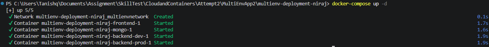
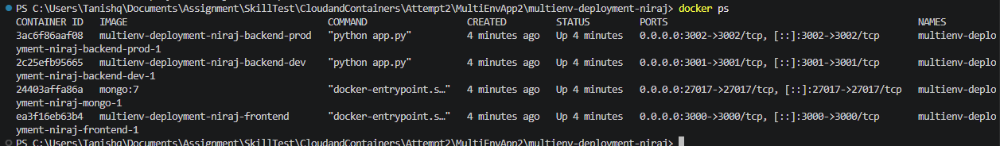
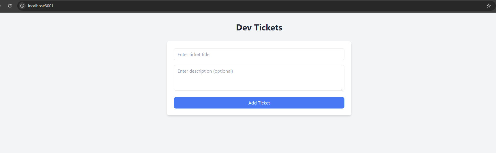
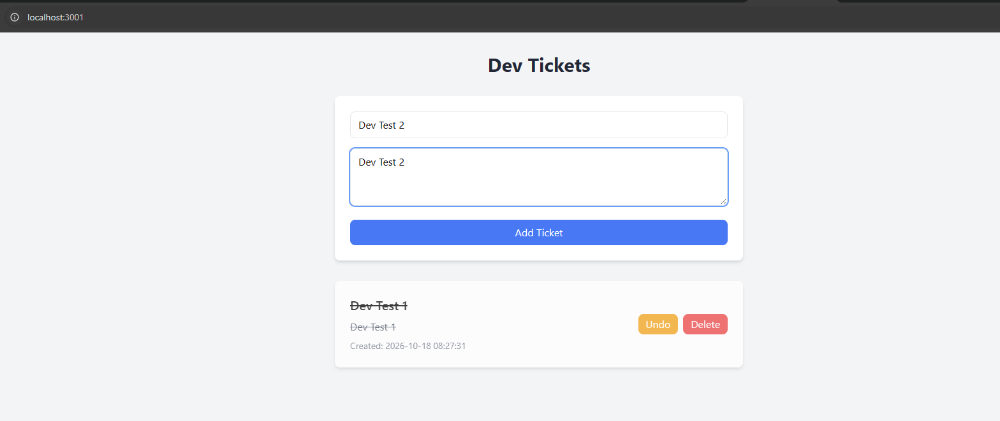
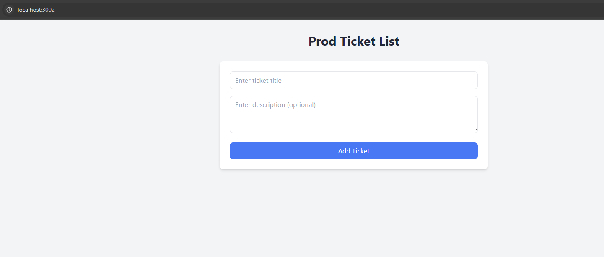
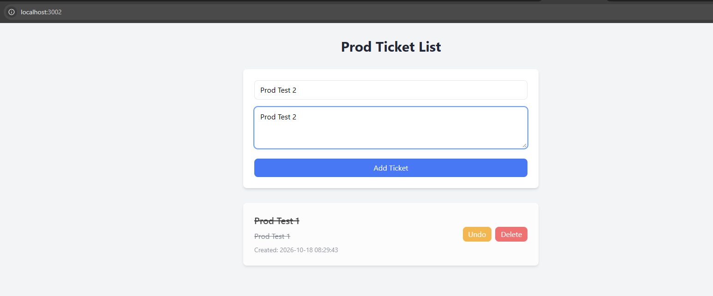
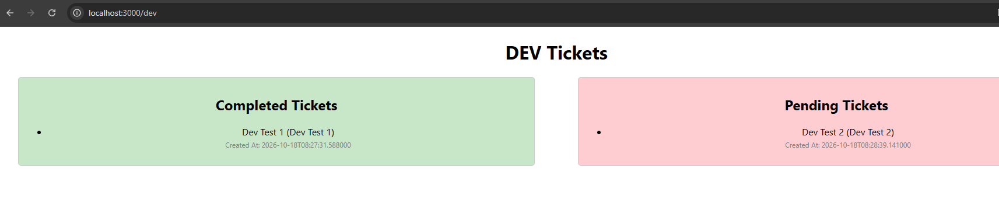
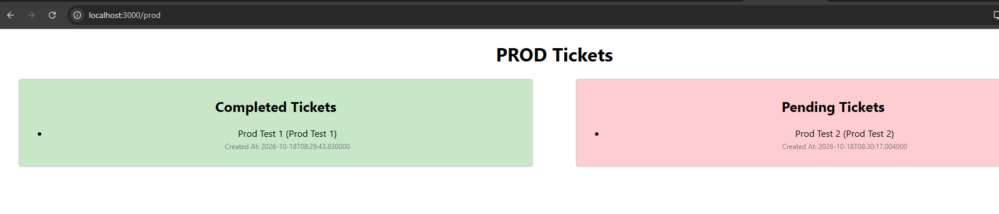

# Multi-Environment Ticket App (Docker Deployment)

**Name:** Niraj Ismail Shaikh
**Assessment:** Multi-Environment Application Deployment
**Date:** 18-10-2026
**Status:** Working. All 4 containers are up and the frontend is talking to both backends.

So this project is a ticket management app that I deployed with Docker
Compose. There's a React frontend and two separate Flask backends, one for dev
and one for prod. Each backend has its own MongoDB database, and everything
runs on one Docker bridge network that I created in the compose file.

---

## How to run it

```bash
git clone https://github.com/shaikhniraj/multienv-deployment-niraj.git
cd multienv-deployment-niraj

# make the .env files from the examples
cp backend/dev/env.example  backend/dev/.env
cp backend/prod/env.example backend/prod/.env

# build and start everything
docker compose up -d --build

# check the frontend logs and wait for "Compiled successfully!"
docker compose logs -f frontend
```

After that open <http://localhost:3000>. If you're running it on EC2 instead of
locally, just use the EC2 public IP instead of localhost.

One thing to know: the databases start empty, so you won't see any tickets at
first. Add a few from the backend pages at <http://localhost:3001/> and
<http://localhost:3002/> and then they'll show up on the frontend.

---

## What you need

- Docker Desktop (Windows/Mac) or Docker Engine (Linux) to run the containers
- Docker Compose V2 (comes with Docker Desktop as `docker compose`)
- Git to clone the repo
- Ports 3000, 3001, 3002 and 27017 free

You can check your setup with `docker --version` and `docker compose version`.

---

## Services

- **frontend** – React dashboard with `/dev` and `/prod` pages. Built from
  `./frontend` on `node:20-alpine`, port 3000.
- **backend-dev** – Dev API and ticket UI. Built from `./backend/dev` on
  `python:3.9-slim`, port 3001.
- **backend-prod** – Prod API and ticket UI. Built from `./backend/prod` on
  `python:3.9-slim`, port 3002.
- **mongo** – MongoDB using the `mongo:7` image, port 27017. It has one
  database for each environment.

The backends connect to the database using `mongodb://mongo:27017`. Here
`mongo` is just the service name from the compose file, and Docker's DNS
resolves it because they're all on the same network. I had to publish ports
3001 and 3002 to the host because the React pages call the APIs directly from
the browser, not from inside the container.

---

## URLs

- Frontend: <http://localhost:3000>
- Dev tickets: <http://localhost:3000/dev>
- Prod tickets: <http://localhost:3000/prod>
- Dev backend UI: <http://localhost:3001/>
- Dev API: <http://localhost:3001/api/tickets>
- Prod backend UI: <http://localhost:3002/>
- Prod API: <http://localhost:3002/api/tickets>
- MongoDB (for Compass etc.): `mongodb://localhost:27017`

---

## Environment files

`backend/dev/.env`

```
PORT=3001
MONGO_URI=mongodb://mongo:27017/tickets_dev
```

`backend/prod/.env`

```
PORT=3002
MONGO_URI=mongodb://mongo:27017/tickets_prod
```

The compose file also sets `ENV=dev` and `ENV=prod` for each backend. I didn't
commit the real `.env` files (they're in `.gitignore`), but the `env.example`
files have the same values so anyone who clones the repo can get it running.

---

## Folder structure

```
multienv-deployment-niraj/
├── docker-compose.yml
├── README.md
├── backend/
│   ├── dev/
│   │   ├── app.py
│   │   ├── requirements.txt
│   │   ├── Dockerfile
│   │   ├── env.example
│   │   └── templates/index.html
│   └── prod/
│       ├── app.py
│       ├── requirements.txt
│       ├── Dockerfile
│       ├── env.example
│       └── templates/index.html
├── frontend/
│   ├── Dockerfile
│   ├── package.json
│   ├── public/
│   └── src/
│       ├── App.js
│       └── pages/  (Home.js, Tickets.js)
├── docs/
│   ├── DEPLOYMENT-GUIDE.md
│   ├── TESTING-EVIDENCE.md
│   ├── ASSUMPTIONS-AND-LIMITATIONS.md
│   ├── TROUBLESHOOTING.md
│   └── VIVA-PREP.md
├── evidence/          (screenshots)
└── submission/submission-info.txt
```

---
-  environment setup
     Download and Install Docker Desktop this will include docker and docer compose
     Network we will create with docker compose directly for internal communiation
   
---

## Checking that it works

# all 4 containers should be up
docker compose ps

# each backend should return its own environment
Browse Development URL http://localhost:3001/
Add some tickets and Mark few as completed 

Browse Production URL http://localhost:3002/
Add some tickets and mark few as completed

Browse Frontned http://localhost:3000
Now go to each of the option Development and Prodction Enviromewnt to see if tickets added in previous steps lists with pending and completed tickets. 


---

## Screenshots

All my screenshots are below.

### 1. Starting everything with `docker compose up -d --build`



### 2. All containers running (`docker ps`)



### 3. Dev backend UI (http://localhost:3001)



### 4. Adding a ticket in the dev backend



### 5. Prod backend UI (http://localhost:3002)



### 6. Adding a ticket in the prod backend



### 7. Frontend showing dev tickets (http://localhost:3000/dev)



### 8. Frontend showing prod tickets (http://localhost:3000/prod)




---

## Troubleshooting

- **localhost:3000 won't load** – React is probably still compiling, wait for
  `Compiled successfully!` in the logs.
- **No tickets showing** – the databases are empty at the start, add some at
  <http://localhost:3001/> and <http://localhost:3002/>.
- **`bind: address already in use`** – something else is using that port. Stop
  it, or change only the host side of the mapping, e.g. `"3100:3000"`.
- **`ServerSelectionTimeoutError`** – make sure the `mongo` container is running
  and `MONGO_URI` uses `mongo` as the host, not `localhost`.
- **Code changes not showing up** – rebuild with `docker compose up -d --build`.

More details are in [`docs/TROUBLESHOOTING.md`](docs/TROUBLESHOOTING.md).

---

## Commands I used a lot

```bash
docker compose up -d --build     # rebuild and start
docker compose up                # Starts containers 
docker compose ps                # check status
docker compose logs -f <service> # follow logs for one service
docker compose restart           # restart everything (data is kept)
docker compose down              # stop and remove containers, keep the data
```

---

## Limitations

There are a few things I know aren't ideal:

- The API URLs in the frontend are hard-coded to `localhost`, so the dashboard
  only loads data when the browser is on the same machine as Docker. If using EC2 we need to update IPs of EC2 in Tickets.js
- MongoDB is local and has no authentication and its port is open so I could inspect it.